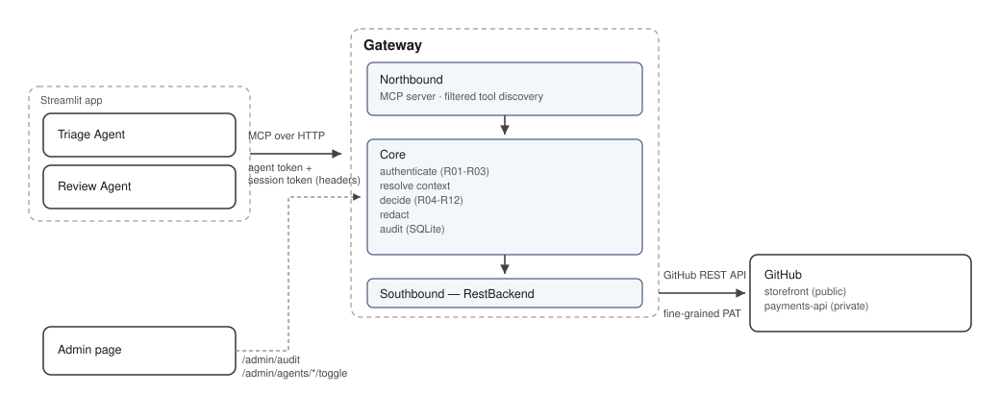

# MCP Gateway — Technical Documentation

## Overview

Two AI agents (Issue Triage, PR Review) reach GitHub only through one MCP gateway. The gateway allows, denies, or redacts every tool call based on agent identity, declared intent, the human user behind the request, and the sensitivity of the data being asked for. The LLM proposes tool calls; the gateway decides — enforcement lives outside the model entirely.

Run instructions, environment setup, and repo layout are in the [README](../README.md). This document covers the approach, the key design decisions, what's built versus deferred, how it's tested, and what's left.

## Approach

Governance has to sit outside the agents, not inside their prompts — a careless or compromised agent shouldn't be the only thing standing between a GitHub repo and someone who isn't supposed to read it. The gateway sits in between: agents only ever see its own tool catalog, never GitHub directly, and every call runs through a fixed decision pipeline before anything is fetched.

The two agents share infrastructure but not data access. Issue Triage works the issue queue — reads issues, suggests duplicates, applies labels. PR Review reads code and comments on pull requests. They're deliberately different in what they can touch: issue content is something anyone outside the org can write, while PR review needs real source code. That asymmetry is what makes "the same call behaves differently depending on which agent made it" something the policy engine has to actually prove, not just claim.

The piece that talks to GitHub is swappable behind one interface (`GitHubBackend`). Own-gateway mode — the gateway calling the GitHub REST API directly — is what's built. A proxy mode in front of GitHub's official MCP server is a documented seam, not an implementation; see Built vs. Deferred below.

## Key Design Decisions

| Decision | Choice | Why | Rejected |
|---|---|---|---|
| Upstream | Swappable backend behind one interface | Own tools for now; the product this mirrors also has to govern servers it didn't write, so the seam has to exist either way | Committing to a single upstream |
| Tool catalog | The gateway's own canonical catalog, identical in every mode | Agents, policy, and tests never change between modes; dangerous operations (merge, approve, close) simply don't exist in the catalog | Passing upstream tools straight through |
| Transport | MCP over streamable HTTP | A real network boundary with headers for tokens; agent and gateway are separate processes | stdio — runs in-process, no auth boundary |
| User + intent | Signed, short-lived session token minted by the UI, never set by agent code | Anchors who's asking and what they're allowed to do outside the LLM's reach — a compromised agent can't forge either one | Headers set by agent code, or intent inferred from the prompt |
| Intent scope | One intent per session | Matches one task, limits blast radius, easy to audit | Intent per request — an agent could change it mid-task |
| Policy format | YAML, default deny, ordered numbered rules | Deterministic, readable, reviewable like code | OPA/Cedar — a real option for production, not needed at this scope |
| Failure mode | Fail closed everywhere: bad config, expired session, a mid-decision exception | A security control that fails open isn't a security control | Fail open for availability |
| Audit storage | SQLite, append-only, one row per decision | Queryable with plain SQL for the admin page, zero extra infrastructure — one file, no separate database service to stand up for two users and two repos | Plain log files (not queryable); Postgres or another client-server DB (real option once usage grows past one process — see Scale) |
| Least privilege | Filtered tool discovery *and* call-time enforcement | The agent doesn't even see tools it can't use, and the rule still fires if it tries anyway | Discovery filtering alone, with no call-time check |
| Policy reload | Manual, admin-triggered (`POST /admin/policy/reload`), not a background watcher | Predictable and easy to demo; a bad reload attempt fails closed — the error is returned and the last-known-good policy keeps serving, nothing in between | An automatic file-watcher — more moving parts, harder to reason about a reload racing an in-flight request |

## Built vs. Deferred

Scope for this version: the REST backend, the full decision engine, and every must-have and should-have governance case — all implemented and proven by tests, not just designed. Listing what's deferred here is deliberate, not an oversight list: each one was a conscious cut, not something missed.

- **Proxy mode (**`McpBackend`**)** — the interface exists; not built, because the REST path alone is enough to prove the policy engine, and the brief reads like a gateway that owns its tools.
- **Anomaly flag** — flagging unusual denial rates per agent. A stretch feature, cut to keep the core decision engine solid first.
- **Tamper-evident (hash-chained) audit log** — same reasoning. The audit log itself is real and complete; it's just not chained.
- **Redaction beyond the basic regex pass** — token-shaped strings and emails are redacted on every response; deeper content scanning wasn't needed for the two demo repos.

## Fixes Made During Implementation

A few things in the original design didn't survive contact with real code:

- **`get_pr_diff`'s decision order** — the original design fetches the PR's changed-file list from GitHub before checking role/repo/intent, contradicting its own "decide before fetching" principle. Fixed by splitting the decision into `decide_phase1` (role/repo/intent/arg checks, no I/O) and `decide_phase2` (tier checks); the metadata lookup only runs if phase 1 passes, and a failure during that lookup fails closed rather than falling through to ALLOW.
- **`policy.yaml` needed a `repos:` block** — the design referenced a repo registry for visibility (public/private) but never showed its schema. Added as a top-level `repos:` map, validated at load time against every repo referenced elsewhere in the file.
- **`post_review_comment` has no `event` argument** — the canonical tool catalog lists this tool's args as `repo, number, body` only, but the policy YAML excerpt had a constraint as if `event` were a real argument. Removed — "comment only" is structural (the backend method can't approve anything), not an argument check.
- **Post-ALLOW backend failures stay ALLOW** — if policy allows a call but the GitHub fetch then fails, the audit row keeps `outcome: ALLOW` plus a `fetch_error` field, distinct from a failure before the decision is finalized, which fails closed.
- **Session expiry is a hard stop** — 15-minute JWT, no silent renewal.

## Testing

Three layers: unit tests for the decision logic itself (no I/O), contract tests run against every backend, and scenario tests that run the entire gateway — real MCP transport, real auth headers, real audit log — against an in-memory GitHub stand-in. Every governance case below is a passing test, not a claim:

| Demo case | Test | Result |
|---|---|---|
| Happy path | `test_happy_path.py` | ALLOW |
| Unknown agent | `test_r01_unknown_agent.py` | DENY `R01` |
| Intent spoofing | `test_intent_spoofing.py` | DENY `R07` |
| Wrong resource type for intent | `test_r09_outside_intent.py` | DENY `R09` |
| Sensitive path | `test_r08_secret_path.py` | DENY `R09` (direct read) / DENY `R08` (PR diff touching a secret file) |
| Same call, different agents | `test_same_call_different_agents.py` | ALLOW for the review agent, DENY `R09` for the triage agent |
| Default deny (unmapped tool) | `test_default_deny.py` | DENY `R06` |
| Prompt injection | `test_prompt_injection.py` | DENY `R09` — the hijacked call is blocked regardless of what the issue body asked for |
| Audit trail | `test_audit_trail.py` | Exactly one row per call, including the two-step `get_pr_diff` lookup |
| Repo-attribute access control | `test_repo_abac.py` | DENY `R10` for a user without repo access, ALLOW for one with it |
| Read vs. write | `test_read_vs_write.py` | DENY `R07` for a write outside the intent, ALLOW for one inside it |
| Filtered tool discovery | `test_filtered_discovery.py` | Catalog is filtered per agent; enforcement still applies even if a hidden tool is called directly |
| Human identity propagation | `test_identity_propagation.py` | Same agent, same intent, different user → different outcome |
| Kill switch | `test_kill_switch.py` | DENY `R02`, takes effect immediately, other agents unaffected |
| Fail closed | `test_fail_closed.py` | DENY `R03` on an expired session; DENY `fail_closed` on a mid-decision failure |

See [README → Testing](../README.md#testing) for the exact commands, including the live-GitHub contract tests.

## Language Choice

**Current version: Python** — an integration choice, not a performance one. The official MCP SDK is most mature here, and `pydantic`, `httpx`, `Starlette`, and Streamlit cover every other piece with no custom plumbing.

**Commercially, the product isn't GitHub-specific** — it's a general MCP/data-platform governance layer (GitHub is just this demo's one backend). The swappable-backend pattern already built (`GitHubBackend` as a `Protocol`) is what has to generalize: one interface per platform, policy/audit core staying backend-agnostic as it already is. That shifts the language question from "what fits GitHub" to "what fits building many backend adapters safely."

| Language | Strength | Weakness |
|---|---|---|
| Go | Goroutines make the `Scale` concurrency bug structurally hard to cause, not just avoidable by discipline; the standard language for this product category | Thinner MCP and schema-validation ecosystems than TS/Python |
| TypeScript/Node | Closest to MCP's own reference ecosystem — most community servers are TS-first | Same single-threaded-event-loop exposure as Python |
| Rust | Strongest safety guarantees, useful with many third-party credentials in play | Slower to build and review, smaller hiring pool |

**My pick: Go.** TypeScript is the stronger ecosystem fit, but Go is the stronger reliability fit — it doesn't just make the blocking-call mistake in `Scale` less likely, it makes it structurally hard to cause at all, which matters more for a product whose entire pitch is trustworthy enforcement under load. Not urgent: Python is fine today, and the `Scale` fix (an async client) closes the same bug without a rewrite.

**If the product already exists inside a company with an established stack**, that wins over any of the above — shared auth, observability, and deployment tooling matters more than this argument.

## Scale

Numbers below are architectural estimates from how each piece is actually built, not load-test results — but they're concrete, and each limit maps to one specific, small fix.

| Component | Current capacity | What limits it | To scale it |
|---|---|---|---|
| Gateway process | ~1 GitHub call in flight at a time — each one blocks the event loop for its full round trip (typically 100-800ms) | `RestBackend` uses a blocking `httpx.Client`, called directly inside the async MCP handler | Swap to `httpx.AsyncClient` (or run the call via `asyncio.to_thread`) — the loop could then hold hundreds of calls in flight, limited by GitHub, not Python |
| GitHub API | 5,000 requests/hour, shared across every agent and every user (GitHub's documented per-token limit) | One fine-grained PAT for the whole gateway | Per-user OAuth tokens instead of one shared PAT — N active users means N separate 5,000/hour budgets instead of one divided N ways |
| Audit log | Single writer; SQLite on local disk typically sustains low hundreds to low thousands of small inserts/second | One `audit` table, one `threading.Lock`, a commit per row (`gateway/core/audit.py`) | Swap SQLite for Postgres (or enable WAL mode as a smaller first step) — `AuditLog` is one module, so this is a backend swap, not a redesign |
| MCP sessions | Up to 10,000 concurrent sessions (the MCP SDK's own built-in default) | Not a near-term constraint | Pass `max_sessions=N` to `StreamableHTTPSessionManager` in `gateway/server.py` if it ever becomes one — not currently exposed as config, so this is a one-line code change |

At the current scale — 2 configured users, 2 agents, 2 demo repos — none of this is felt: a handful of people clicking through the demo at once, each waiting on their own response, stays well under every limit above.
